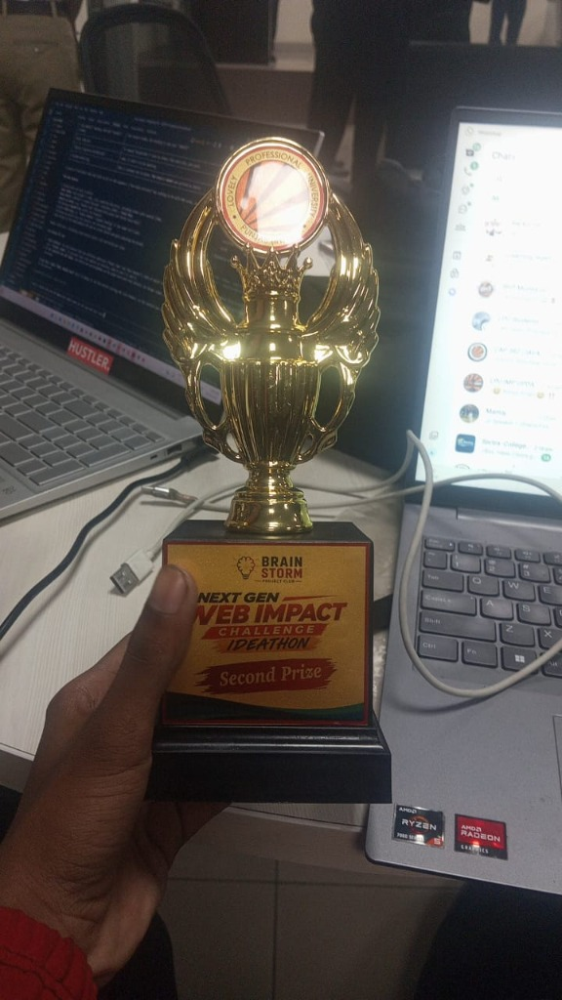
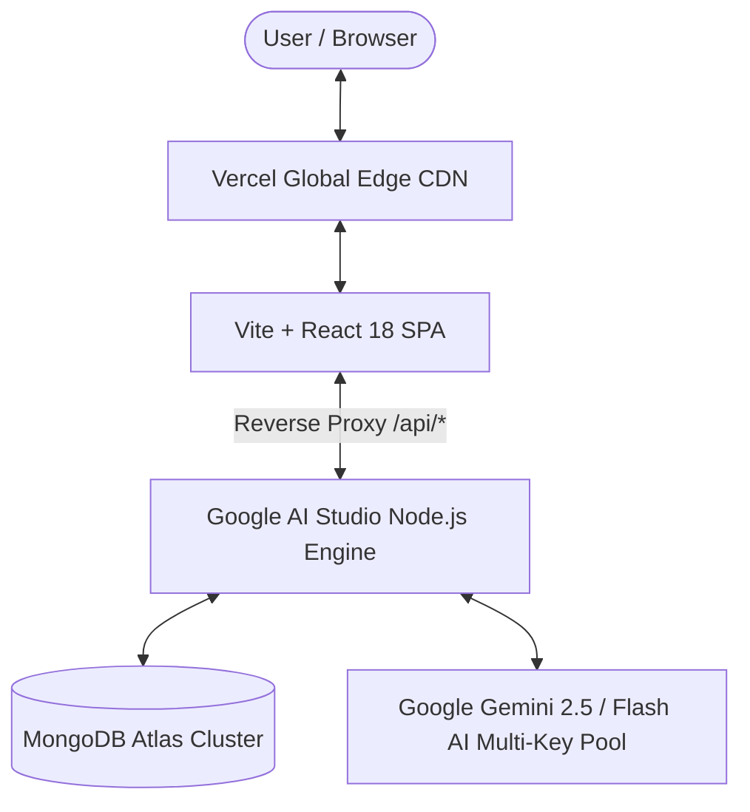

# 🚀 Career Navigation AI — Frontend Client & Web Platform

[-FFD700?style=for-the-badge&logo=target&logoColor=black)](https://carrer-nav-ai.vercel.app)
[](https://github.com/raj40870-pixel/Ai-skill-)
[](https://carrer-nav-ai.vercel.app)
[](https://react.dev/)
[](https://www.typescriptlang.org/)
[](https://vitejs.dev/)
[](https://tailwindcss.com/)
[](LICENSE)

---

## 🏆 Award & Ideathon Recognition

### 🥈 **1st Runner-Up (Second Prize) — Next Gen Web Impact Challenge Ideathon**
* **Rank / Standing:** **1st Runner-Up** (2nd Place Overall)
* **Event:** Next Gen Web Impact Challenge Ideathon (November 2026)
* **Organized by:** Brain Storm Project Club • Lovely Professional University (LPU)
* **Awarded to:** **Team The Hustlers**
* **Team Members:**
  * **Kamaljit** — Lead Full-Stack Architect & AI System Engineer (BCA, Lovely Professional University)
  * **Mantaj** — Co-Developer & UI/UX Presentation Lead (Team The Hustlers)
* **Live Production App:** [carrer-nav-ai.vercel.app](https://carrer-nav-ai.vercel.app)
* **Pitch Deck:** [Presentation Deck (.pptx)](public/The_Hustlers_Career_Nav_AI_Presentation.pptx)

<div align="center">
  
  <p><em>🏆 Team The Hustlers (Kamaljit & Mantaj) awarded 1st Runner-Up Trophy at Lovely Professional University</em></p>
</div>

---

An enterprise-grade, full-stack AI career acceleration platform. **Career Navigation AI** combines real-time resume parsing, **Dual-Engine ATS scoring**, dynamic 4-role market calibration, personalized 30-60-90 day learning roadmaps, interactive STAR interview coaching, and localized salary benchmarks powered by Google Gemini AI.

---

## 🌟 Key Platform Features

### ⚡ 1. Zero-Friction Instant ATS Guest Scan
- **Instant 2-Second Audit:** Visitors can drag & drop any PDF, Word (`.docx`), or image resume without mandatory sign-up walls.
- **Zero Database Pollution:** Guest scans run ephemeral in-memory audits creating zero permanent records in MongoDB.
- **Seamless Account Import:** When a guest decides to create an account, their scanned resume and career profile are automatically imported.

### 🎯 2. Dual-Engine ATS Optimization Engine
- **Universal ATS Baseline Score (~71/100):** Objective document quality metric measuring layout readability, typography hierarchy, quantifiable KPI density, and contact link validity independently of target role bias.
- **Role-Calibrated Match Fit (%):** Evaluates strictly against target role benchmarks (e.g. Full Stack Engineer, Cloud Architect) for keyword coverage, hard skill requirements, and seniority expectations.
- **8-Factor 100-Point Rubric:** Granular scoring across Document Length, Action Verbs, Measurable Impact, Hard Skills, Section Balance, Repetition/Cliches, Formatting, and Education.
- **Before vs. After Google XYZ Bullet Lab:** Weak bullet points automatically transformed using Google's formula: *Accomplished [X] as measured by [Y] by doing [Z]*.
- **Grammar & Repetition Radar:** Identifies overused buzzwords (*"hardworking"*, *"team player"*), duplicate phrases, and weak passive voice verbs.
- **4 Auto-Detected Target Roles:** AI analyzes candidate experience to suggest 4 market-aligned landing roles with 1-click re-audit calibration.

### 🗺️ 3. Personalized Career Roadmaps
- Structured 6-month progression divided into agile two-week sprints.
- Actionable weekly deliverables: real-world projects, certified curriculum links, and targeted skill acquisition.
- Shareable public roadmap links for mentors, recruiters, and peers.

### 🎤 4. STAR Interview Prep Simulator
- Behavioral, situational, and deep technical questions tailored to candidate's parsed skills.
- Real-time AI evaluation scored on Situation, Task, Action, and Result (STAR) framework.
- Multi-lingual voice support: Speak in Hindi or English with automatic speech-to-text and instant English translation before evaluation.

### 💰 5. Verified Market & Salary Benchmarks
- Real compensation intelligence adjusted by region (Global, USA, India, Remote) and seniority.
- In-demand skill matrices and hiring velocity trends.

### 🎮 6. Gamification & Executive PDF Exports
- Experience points (XP), daily streaks, and milestone badges.
- One-click professional multi-page Career Audit PDF generation with high-resolution vector charts.

---

## 🏗️ Architecture & Tech Stack



- **Frontend Core:** React 18, Vite 6, TypeScript
- **Styling & UI:** Tailwind CSS, Framer Motion (`motion/react`), Lucide React Icons
- **Data Visualization:** Recharts, HTML5 Canvas
- **Notifications & UI Polish:** Sonner Toast Engine, Radix UI primitives
- **Document Export:** jsPDF, html2canvas, docx parser, pdfjs-dist

---

## 📁 Repository Structure

```
ai-career-navigation/
├── public/                 # Static brand assets and favicons
├── src/
│   ├── components/         # Core UI views & modular feature tabs
│   │   ├── ATSScoreTab.tsx        # Dual-Engine ATS scoring & breakdown
│   │   ├── CareerRoadmapTab.tsx   # Sprint-based learning path
│   │   ├── Dashboard.tsx          # Main career command center
│   │   ├── InterviewPrepTab.tsx   # STAR interview practice simulator
│   │   ├── LandingPage.tsx        # High-converting guest landing page
│   │   ├── SalaryInsightsTab.tsx  # Compensation benchmarks
│   │   └── ...
│   ├── lib/                # Telemetry, PDF generator & API helpers
│   ├── services/           # Gemini API & backend service client
│   ├── App.tsx             # Root application controller & routing
│   └── main.tsx            # React DOM hydration entry point
├── dist/                   # Production build outputs
├── vercel.json             # Vercel deployment & API reverse-proxy config
├── package.json
└── tsconfig.json
```

---

## 🚀 Getting Started Locally

### Prerequisites
- **Node.js:** v18.0.0 or higher
- **npm:** v9.0.0 or higher

### 1. Clone the Repository
```bash
git clone https://github.com/raj40870-pixel/Ai-skill-.git
cd Ai-skill-
```

### 2. Install Dependencies
```bash
npm install
```

### 3. Configure Environment Variables
Create a `.env.local` file in the root directory:
```env
# Optional: Set backend API URL for local development (leave empty to use Vercel proxy)
VITE_API_URL=http://localhost:3000

# Client-side AI fallback key (if running standalone without backend)
GEMINI_API_KEY=your_gemini_api_key_here
```

### 4. Run Development Server
```bash
npm run dev
```
Open [http://localhost:5173](http://localhost:5173) in your browser.

### 5. Production Build
```bash
npm run build
```
Generates an optimized client bundle in `dist/` and standalone server bundle in `dist/server.cjs`.

---

## 🚢 Deployment (Vercel)

The repository is configured for zero-configuration continuous deployment on Vercel:
1. Connect this GitHub repository to your Vercel project.
2. In `vercel.json`, backend requests (`/api/*`) are automatically routed to the production backend:
   ```json
   {
     "rewrites": [
       { "source": "/api/:path*", "destination": "https://career-navigation-ai.ai.studio/api/:path*" },
       { "source": "/(.*)", "destination": "/index.html" }
     ]
   }
   ```
3. Every push to `main` automatically triggers an optimized Vite build and deploys worldwide.

---

## 🔒 Security & Privacy

- **Zero-Log Guest Mode:** Anonymous resume scans do not store files or candidate PII in MongoDB.
- **Enterprise JWT Authentication:** Secure, salted bcrypt password hashing and Bearer token sessions.
- **Content Security:** Strict client-side document sanitization with DOMPurify.

---

## 📄 License

This project is open-source and available under the [MIT License](LICENSE).
